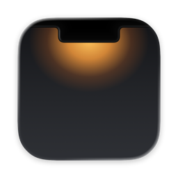
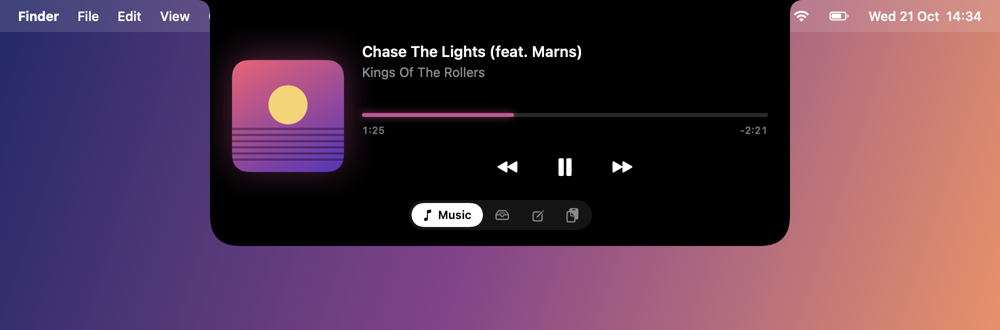
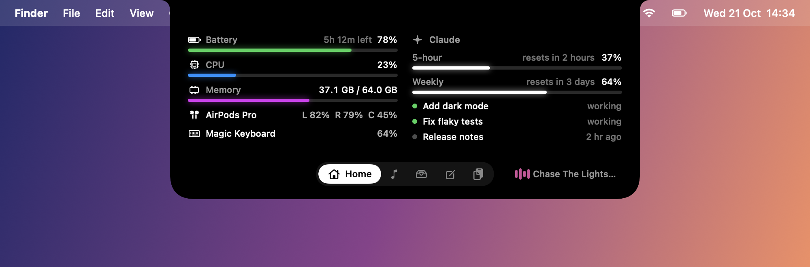
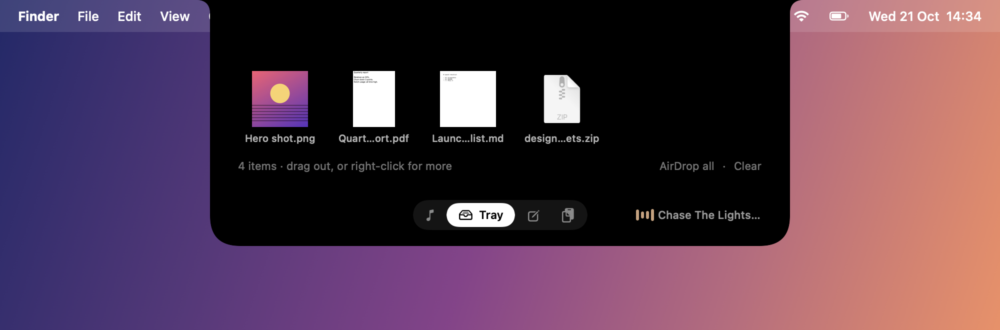
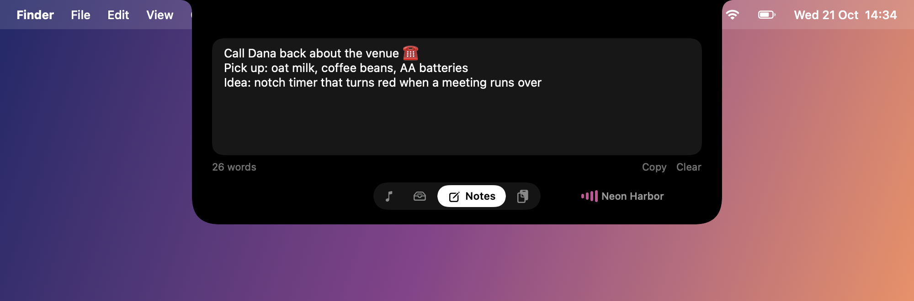
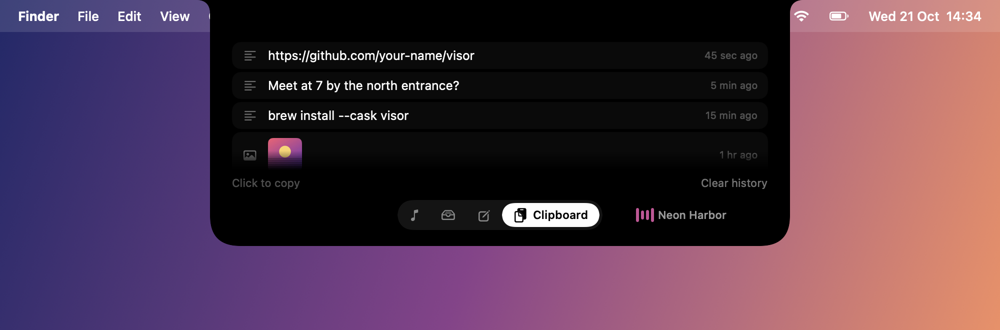
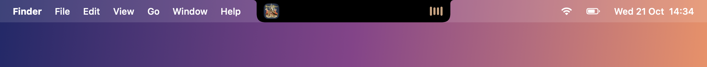
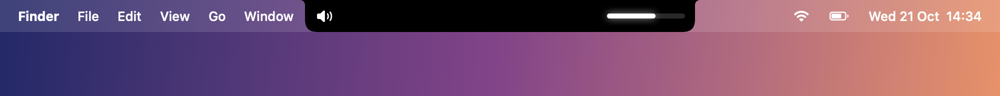
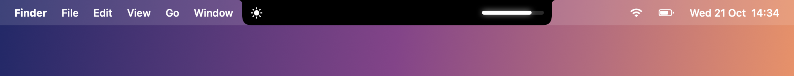
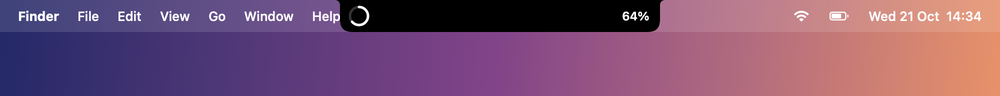

<div align="center">



# Visor

**Your MacBook notch, put to work.**
A home dashboard (battery, AirPods, CPU, memory, Claude Code agents and limits), now playing, a file tray, quick notes, clipboard history, live downloads and a cleaner volume/brightness HUD, all in the notch.



Native Swift + SwiftUI · ~2.1k lines · no dependencies · offline by default · macOS 14+

<a href="https://ponytail.dev"></a>
<a href="https://buymeacoffee.com/sergiuradulea"></a>


</div>

---

## Features

Hover the notch to open it. Everything lives in five tabs along the bottom.

| | |
|---|---|
|  | **🏠 Home**<br>Your Mac at a glance: battery and time left, CPU, memory, and the battery of connected AirPods (left, right, case), keyboards and mice. On the right, every **Claude Code agent** running on this Mac (busy or idle) and, if you turn it on, your **Claude plan limits** (5-hour and weekly, with reset times). Only refreshes while the tab is open. |
|  | **🎵 Music**<br>Artwork, title, artist, a seekable progress bar and playback controls for whatever is playing (Music, Spotify, browsers, anything that shows up in Control Center). Colours are pulled from the album art. While something plays, the closed notch shows the artwork and a live visualizer. |
|  | **📥 Tray**<br>Drag files onto the notch to park them, then drag them out wherever you need them. Right-click a file to Open, Show in Finder, AirDrop, Share, Copy or Copy Path. **New screenshots and finished downloads land here automatically.** Screenshots are picked up from whichever folder you save them to (Cmd+Shift+5 → Options → Save to), so there's nothing to configure. |
|  | **📝 Notes**<br>A scratchpad that saves as you type. The notch stays open while you're typing and closes when you click elsewhere. |
|  | **📋 Clipboard**<br>Your last 40 text and image copies. Click one to copy it again. Copies that password managers mark as concealed are never recorded. |

### In the closed notch

| | |
|---|---|
|  | Now playing |
|  | Volume HUD (replaces the system one) |
|  | Brightness HUD |
|  | Live download progress (Safari, Chrome, Firefox) |

**Floating basket:** shake the pointer while dragging files and a floating tray appears next to it.

---

## Install

Visor is built from source. That takes about a minute and means you run exactly the code you can read here.

### What you need

| | |
|---|---|
| **macOS 14 Sonoma or later** | Works on any Mac. With a notch it sits over the notch; without one it shows as a small pill at the top of the screen. |
| **Apple's Command Line Tools** | Free from Apple. Install with `xcode-select --install`, or use Xcode if you already have it. Includes Swift and `git`. |
| **About a minute** | For the first build. Later builds take a few seconds. |

You **don't** need an Apple developer account, Xcode or Icon Composer, and nothing is downloaded during the build: Visor has no dependencies.

Check you're ready:

```bash
sw_vers -productVersion   # 14.0 or higher
swift --version           # if this fails, run: xcode-select --install
```

### Build and install

```bash
git clone https://github.com/sergiuradulea/visor.git
cd visor
./build.sh
cp -R build/Visor.app /Applications/
open /Applications/Visor.app
```

Then grant the permissions it asks for. macOS shows each prompt the first time a feature needs it:

| Permission | Why | Without it |
|---|---|---|
| **Accessibility** | To catch the volume and brightness keys and show Visor's HUD instead of the system one | Keys work as normal, with no custom HUD |
| **Downloads folder** | To see download progress and add finished files to the tray | No live downloads |
| **Desktop folder** (only if screenshots save there, the macOS default) | To add new screenshots to the tray | Screenshots aren't added |
| **Bluetooth** | To read AirPods, keyboard and mouse battery levels on the Home tab | Device batteries aren't shown |
| **Keychain: "Claude Code-credentials"** (opt-in, only if you click *Show plan limits*) | To read your Claude Code login and fetch your plan limits from Anthropic. Note that this keychain item also contains your Claude Code connector logins (Slack, Notion and so on); Visor ignores them, but the permission covers the whole item. | No limits shown; everything else works |

> **Only use Claude Code inside the Claude desktop app?** The desktop app keeps its login to itself, so sign in to the command-line Claude Code once for the limits to work: run `claude` in Terminal, type `/login`, choose your Claude account, then `/exit`.

To start Visor at login, right-click the notch and choose **Open at Login**. **Quit** is in the same menu.

### Let Claude do it

Prefer not to touch the terminal? Paste one of these prompts into [Claude Code](https://claude.com/claude-code) or the Claude desktop app's Code tab. Any coding agent with terminal access works the same way.

**1. Check it first: independent security review**

Don't take our word for the claims below. Ask Claude to verify them against the source before anything runs:

```text
Clone https://github.com/sergiuradulea/visor into a temporary folder and do a
security review of it BEFORE building or running anything. Read every file in
Sources/, plus build.sh and Package.swift. Don't trust the README or comments;
check the code itself. Specifically verify, citing file and line:

1. Network: does anything open sockets, make HTTP requests or contact a server?
2. Keyboard: what event types does the CGEventTap subscribe to? Could it ever
   see normal keystrokes (keyDown/keyUp) or text I type?
3. Processes: what does it launch, with which arguments? Is a shell ever used,
   or user/clipboard data passed to a command?
4. Files: what does it read and write, where, and does it ever delete, move or
   upload my files?
5. Clipboard: what is stored, where, and is anything sent elsewhere? Are
   password-manager (concealed) copies really skipped?
6. Private APIs: list every dlopen/dlsym and what each is used for.
7. Build script: does build.sh download anything or touch anything outside
   the project folder (apart from reading my keychain for a signing identity)?
8. Anything else suspicious: obfuscated code, encoded strings, hidden flags.

Give me a short verdict (safe to install / concerns), then the evidence.
Don't build or install anything yet.
```

**2. Install it**

```text
Install Visor from https://github.com/sergiuradulea/visor on my Mac:
1. Check I have macOS 14+ and the Xcode Command Line Tools; if the tools are
   missing, tell me to run `xcode-select --install` and wait for me.
2. Clone the repo to ~/Developer/visor (or show me the folder you'd use).
3. Run ./build.sh and fix nothing in the source; if the build fails, show me
   the error and stop.
4. Copy build/Visor.app to /Applications and open it.
5. Walk me through granting Accessibility and Downloads access in System
   Settings. I'll click the buttons myself; don't change system settings for me.
6. Tell me how to turn on Open at Login and how to uninstall later.
```

> Run the review prompt first, in a separate conversation, so the install isn't biased by it. If you build from a fork, review that fork, not this repo.

### Keep permissions across rebuilds (optional)

Builds are ad-hoc signed by default, so macOS treats every rebuild as a new app and you have to grant Accessibility again. To avoid that, create a local signing certificate once:

1. Open **Keychain Access → Certificate Assistant → Create a Certificate…**
2. Name it `Visor Dev`, set Identity Type to **Self Signed Root** and Certificate Type to **Code Signing**, then click **Create**.

`build.sh` picks it up automatically ("Signed with: Visor Dev").

### Troubleshooting

- **Volume keys still show the macOS popup.** Add `/Applications/Visor.app` under System Settings → Privacy & Security → Accessibility. After a rebuild, remove the old entry and add it again (or set up the signing certificate above).
- **The Mac feels slow or clicks stop working.** Quit Visor (right-click the notch → Quit, or `killall Visor` in Terminal) and update to the latest version. Versions before Oct 21, 2026 could stall input when Accessibility was removed while Visor was running.
- **Screenshots or downloads don't appear in the tray.** Allow the folder access prompt, or enable it under Privacy & Security → Files & Folders → Visor.

### Update

```bash
git pull && ./build.sh && cp -R build/Visor.app /Applications/
```

### Uninstall

Right-click the notch, choose Quit, then:

```bash
rm -rf /Applications/Visor.app ~/Library/Application\ Support/Visor
defaults delete io.github.visor
tccutil reset All io.github.visor
```

---

## How it works

| Feature | Technique |
|---|---|
| Notch window | A borderless, non-activating panel above the menu bar. A private SkyLight call puts it on its own always-on-top Space, so it doesn't slide or ghost when you swipe between Spaces. |
| Now playing | Since macOS 15.4, the private `MediaRemote` framework only answers clients whose bundle ID starts with `com.apple.`. A ~90-line helper (`VisorMedia`) with such an ID streams JSON to the app over a pipe. |
| Volume / brightness | A session event tap that sees **only** media-key events (`NX_SYSDEFINED`), never ordinary keystrokes. It runs on its own thread and removes itself the moment Accessibility is revoked, so it never slows down system input. Volume goes through CoreAudio and brightness through the private `DisplayServices` framework. |
| Tray | References to your files (paths), never copies. Drag out uses standard file providers. |
| Screenshots | A Spotlight query for `kMDItemIsScreenCapture`, limited to your screenshot folder. |
| Downloads | Subscribes to the `NSProgress` objects browsers publish for files in `~/Downloads`, the same mechanism behind Finder's progress bars. |
| Home | Battery from the IOKit power-source API, CPU and memory from `host_statistics`, device batteries from `system_profiler SPBluetoothDataType` (once a minute). Agents from the `~/.claude/sessions/*.json` files Claude Code keeps up to date. Limits (opt-in) from `api.anthropic.com/api/oauth/usage`, the same call Claude Code's `/usage` makes. |
| Clipboard | Polls `NSPasteboard.changeCount`, as macOS has no change notification, and skips [concealed/transient](http://nspasteboard.org) items. |

```
Sources/
├── Visor/          the app (SwiftUI views, notch window, models)
└── VisorMedia/     MediaRemote helper (com.apple.* bundle ID)
build.sh                builds and signs Visor.app into ./build
Resources/              compiled app icon (committed, so building needs no Xcode)
design/icon/            icon source: SVG layers + visor.icon (Icon Composer); compile.sh rebuilds Resources/
Tests/VisorTests/       unit tests: swift test
docs/screenshots/       generated by: swift run -c release Visor --screenshots docs/screenshots
```

---

## Privacy & security

- **Offline by default.** Visor makes no outgoing connections: no analytics, no update checks. The one exception is the opt-in **Claude plan limits** on the Home tab. Once you turn it on, Visor reads your Claude Code login from the keychain (macOS asks you first) and sends it to `api.anthropic.com` every 5 minutes while the Home tab is open. Nothing else is sent, and the login is never stored, logged or refreshed. Turn it off by right-clicking the Home tab → *Hide Plan Limits*.
- **Your data stays local:**
  - Clipboard history: `~/Library/Application Support/Visor/clipboard.json`, excluded from Time Machine.
  - Notes and the tray list: in the app's preferences.
- **The key tap is narrow:** it only receives media and brightness key events, never text you type.
- **It uses private Apple APIs** (MediaRemote, DisplayServices, SkyLight) and a `com.apple.` helper bundle ID. Expect breakage in a future macOS release. It can't go on the Mac App Store and isn't notarized.

See [SECURITY.md](SECURITY.md) for the full threat model and how to report a vulnerability.

---

## Credits

Built and reviewed with [Ponytail](https://ponytail.dev), the "laziest senior dev in the room" ruleset for AI coding agents: the smallest code that fully does the job, then a review pass for bugs, security and battery/performance.


Inspired by notch utilities like [Droppy](https://getdroppy.app), [boring.notch](https://github.com/TheBoredTeam/boring.notch) and NotchDrop. Visor is an independent, from-scratch implementation; no code or assets are taken from other apps.

## Support

Visor is free and open source. If it makes your day a little easier, you can [buy me a beer 🍺](https://buymeacoffee.com/sergiuradulea). Bug reports and ideas in [Issues](https://github.com/sergiuradulea/visor/issues) are just as welcome.

## License

[MIT](LICENSE)
